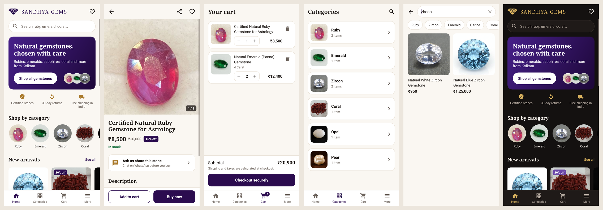

# Sandhya Gems for Android

A small, fast shopping app for [sandhyagems.in](https://sandhyagems.in). Customers
browse gemstones, search, save favourites, fill a cart and pay through the store's
own checkout.



*The photos above are Sandhya Gems' own; the product names and prices are sample data, not the live catalogue.*

## What it does

| Area | Details |
| --- | --- |
| Home | Search, categories, New arrivals, Best sellers, astrology consultation, a link to RashiSutra, WhatsApp and call buttons |
| Categories | Every collection in the store that has products |
| Product page | Photo gallery, price, discount, stock, size/weight options, description, share, wishlist, "Ask on WhatsApp" |
| Search | Results as you type, over the whole catalogue, works offline |
| Cart | Saved on the phone, quantity controls, picks up price and stock changes |
| Checkout | The store's own Shopify checkout, opened inside the app (cards, UPI, COD: whatever the store offers) |
| More | My account and orders, wishlist, contact, shop address with opening hours and directions, policies |
| Extras | Dark mode, opens product links from the website, shows the last saved catalogue when offline |

## Why it is light

- The release APK is about **310 KB**.
- No Firebase, no analytics SDK, no ad SDK. The only permission is Internet.
- Product photos are requested at the size of the screen, not full size, and cached.
- The catalogue is saved on the phone, so the app opens instantly on later launches.

## How it talks to the store

The app reads the public catalogue that every Shopify store serves
(`/products.json`, `/collections.json`), so **no API key or password is stored in
the app**, and products, prices and stock always come from the Shopify admin. There
is nothing extra to maintain.

Checkout uses a Shopify cart link (`/cart/<variant>:<quantity>`), which opens the
store's normal checkout with the chosen items. The app never sees payment details.

## Before you publish: things to check

1. **Test a real order** on a phone from start to finish. The store uses Razorpay
   Magic Checkout on the website; the app opens the standard Shopify checkout link, so
   confirm that payment (UPI, card, COD) completes from inside the app.
2. **Contact details** are in `app/src/main/java/com/sandhyagems/app/StoreConfig.kt`.
   The phone and WhatsApp number come from the store's own notes; confirm the email address.
3. **Shop address and opening hours** shown under More are in
   `app/src/main/res/values/strings.xml` (`store_address`, `store_hours`).
4. **Wording** on the home screen ("Certified stones", "30-day returns", "Free shipping
   in India") is in the same file. Make sure it matches your current policies.
5. **Home page rows** use the collections `new-gem` and `best-seller`. Change the
   handles in `StoreConfig.kt` if you prefer others. A missing collection just hides its row.
6. **Astrology consultation** appears on the home screen when the store has an
   in-stock product with "consultation" in its title.
7. **Colours** follow the logo (deep purple `#2B0C4F` with gold) and are in
   `app/src/main/res/values/colors.xml` (and `values-night` for dark mode).
8. **App icon** is the diamond from the Sandhya Gems logo
   (`res/drawable-xxxhdpi/ic_launcher_foreground.png`).
9. **Built-in gemstone photos** (`res/drawable-nodpi/gem_*.webp`) are the shop's own
   pictures. They appear on the home banner and for any category that has no picture
   set in Shopify (matched by name in `ui/CategoryArt.kt`). Product photos always come
   live from the store.

## Build

Requirements: JDK 17 or newer and the Android SDK (platform 35). Android Studio
installs both.

```bash
./gradlew assembleDebug        # app/build/outputs/apk/debug/app-debug.apk
./gradlew assembleRelease      # app/build/outputs/apk/release/app-release.apk (small, optimised)
./gradlew testDebugUnitTest    # tests; screen pictures are written to app/build/screenshots
```

### Signing for Google Play

Without a signing key, the release build is signed with Android's debug key. That
is fine for installing on your own phone, but Google Play will not accept it.

1. Create a key once (keep this file and its passwords safe; you need the same key for every update):

   ```bash
   keytool -genkey -v -keystore sandhyagems.jks -keyalg RSA -keysize 2048 -validity 10000 -alias sandhyagems
   ```

2. Create `keystore.properties` next to `settings.gradle.kts` (it is ignored by git):

   ```properties
   storeFile=sandhyagems.jks
   storePassword=your-store-password
   keyAlias=sandhyagems
   keyPassword=your-key-password
   ```

3. Build an app bundle for Play: `./gradlew bundleRelease`
   (output in `app/build/outputs/bundle/release/`).

For each new version, raise `versionCode` and `versionName` in `app/build.gradle.kts`.

## Project layout

```
app/src/main/java/com/sandhyagems/app/
  StoreConfig.kt          store address, contact details, page links
  data/                   catalogue loading and caching, cart, wishlist, Shopify URL helpers
  util/                   money formatting, image loader, background threads
  ui/                     screens
app/src/test/             tests and sample store data
```

## Not included

- Push notifications (needs Firebase and a server to send them).
- Native login. "My account and orders" opens the store's account page inside the app.
- Reviews, coupons entered in the app (coupons can be entered at checkout).
